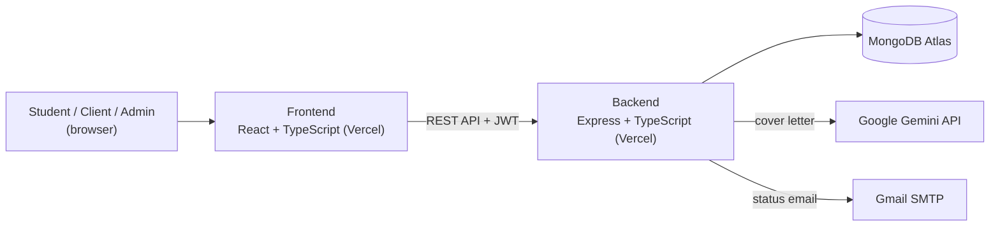
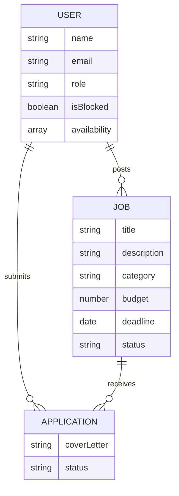
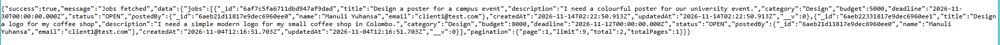

# Student Freelance Job Board - Backend API

> Small freelance jobs for university students, with a weekly free-time timetable so clients can see when a student is available.

Student Freelance Job Board is a web application where **clients** post small paid jobs (posters, tutoring, data entry, simple websites) and **students** apply for them. Each student keeps a weekly timetable of the hours they are free, and the client sees that timetable together with the application. Students can write their cover letter with AI, and get an email when a client accepts or rejects their application.

This repository is the **backend REST API** (Node.js, Express and TypeScript). The user interface is in the [frontend repository](https://github.com/yasadidias/student-freelance-job-board-web).

## Live demo

| | Link |
|---|---|
| Website (frontend) | https://student-freelance-job-board-web.vercel.app |
| API (backend) | https://student-freelance-job-board.vercel.app (try [`/api/jobs`](https://student-freelance-job-board.vercel.app/api/jobs)) |
| Frontend repository | https://github.com/yasadidias/student-freelance-job-board-web |
| Backend repository | https://github.com/yasadidias/student-freelance-job-board |

## About

- **Name:** Yasadi Dias
- **Module / assignment:** ITS2020 Rapid Application Development (RAD), final coursework (individual)

## Tech stack

| Area | Technologies |
|---|---|
| Backend | Node.js, Express 5, TypeScript |
| Database | MongoDB Atlas with Mongoose (validation and indexes) |
| Authentication | JWT (access token 15 min + refresh token 7 days), bcryptjs password hashing, role-based authorization (`USER`, `MANAGER`, `ADMIN`) |
| Validation and security | zod, helmet, CORS allow-list, express-rate-limit, secrets in environment variables |
| AI | Google Gemini (`@google/genai`) for cover letters |
| Email | Nodemailer (Gmail SMTP) |
| Deployment | Vercel (serverless Express), MongoDB Atlas |

## Features

**Core API**
- CRUD for two related entities: **Job** and **Application** (plus User)
- Consistent JSON responses and correct HTTP status codes
- Search, filter and pagination on jobs
- **Two advanced features:** AI cover letter (Google Gemini) and automatic status emails (Nodemailer)

**For students (`USER`)**
- Browse and search open jobs, filter by category, pagination
- Apply to a job with a cover letter (one application per job)
- **Write the cover letter with AI** (Gemini; a template is used if the AI is busy or not configured)
- Track applications and withdraw a pending application
- Save a **weekly free-time timetable** (day and hour cells) that clients can see
- Get an **email** when an application is accepted or rejected

**For clients (`MANAGER`)**
- Post, edit, close and delete their own jobs
- See all applicants of a job with the cover letter and the student's free times
- Accept or reject an application (the student is emailed)

**For admins (`ADMIN`)**
- Dashboard totals (users, students, clients, jobs, open jobs, applications)
- Search users, block / unblock them, delete a user together with their jobs and applications
- Edit or delete any job and manage any application
- The admin account is created by a seed script, so nobody can register as admin

**Security**
- Passwords are hashed with bcryptjs and never returned by the API (`select: false`)
- Every protected route checks the JWT and the user's role
- Input validation with zod, helmet security headers, CORS allow-list
- Rate limits on the login / register routes (against password guessing) and on the AI endpoint (to protect the free quota)
- Secrets only in environment variables; `.env` is not in the repository

## Main flow

1. A client and a student register. Students save their free times on their profile.
2. The client posts a job (title, description, category, budget, deadline).
3. The student finds the job, writes a cover letter (optionally with AI) and applies.
4. The client opens the applicants of that job, reads the cover letter and checks the student's free times.
5. The client accepts or rejects. The student receives an email with the result.

## System design

**Architecture (client-server separation).** The React frontend talks to the Express API over REST with a JWT in the `Authorization` header. Only the backend talks to the database and to the external services.



**Database relationships.** A client (User) posts many Jobs, a Job receives many Applications, and a student (User) submits many Applications.



## Folder structure

```
src/
  config/        database connection
  models/        User, Job, Application (Mongoose schemas)
  controllers/   request handling logic
  routes/        URL -> controller mapping
  middleware/    authenticate, authorize, validate, error handler
  validators/    zod schemas
  services/      AI (Gemini) and email (Nodemailer) helpers
  utils/         JWT helpers, HttpError, shared helpers
  scripts/       seedAdmin.ts (creates the first admin)
  index.ts       app entry point
```

## Getting started (run locally)

You need Node.js 18 or newer and a MongoDB Atlas database (the free tier is enough).

```bash
npm install
copy .env.example .env    # macOS/Linux: cp .env.example .env  (then fill in the values)
npm run seed:admin        # creates the first admin account (only once)
npm run dev               # http://localhost:5000
```

Open `http://localhost:5000/api/jobs` to check that the API works. Build for production with `npm run build`, then `npm start`.

The frontend (see its repository) must use `VITE_API_URL=http://localhost:5000/api` to talk to this API.

## Environment variables

Copy [.env.example](.env.example) to `.env` and fill in the values. Never commit the real `.env` file.

| Variable | Required | Description |
|---|---|---|
| `PORT` | no | Port of the server (default `5000`) |
| `MONGO_URI` | yes | MongoDB Atlas connection string |
| `JWT_SECRET`, `JWT_REFRESH_SECRET` | yes | Two different long random strings |
| `JWT_EXPIRES_IN`, `JWT_REFRESH_EXPIRES_IN` | no | Token lifetimes (default `15m` and `7d`) |
| `CLIENT_URL` | yes | Frontend address(es) allowed by CORS, comma separated |
| `ADMIN_EMAIL`, `ADMIN_PASSWORD` | for `seed:admin` | Details of the first admin account |
| `GEMINI_API_KEY`, `GEMINI_MODEL` | no | AI cover letter. Without a key a simple template is used. Free key: https://aistudio.google.com/apikey |
| `SMTP_HOST`, `SMTP_PORT`, `SMTP_USER`, `SMTP_PASS`, `EMAIL_FROM` | no | Status emails. Without them emails are skipped. For Gmail use an App Password |

## Data models

**User**

| Field | Type | Notes |
|---|---|---|
| `name` | string | 2-60 characters |
| `email` | string | unique, lowercase |
| `password` | string | bcrypt hash, hidden from queries |
| `role` | `USER` / `MANAGER` / `ADMIN` | default `USER` |
| `isBlocked` | boolean | set by an admin |
| `availability` | list of `{ day, hour }` | weekly free times (`MON`-`SUN`, hour 0-23) |

**Job**

| Field | Type | Notes |
|---|---|---|
| `title` | string | 5-100 characters |
| `description` | string | 20-2000 characters |
| `category` | enum | Design, Tutoring, Data Entry, Writing, Development, Other |
| `budget` | number | not negative |
| `deadline` | date | |
| `status` | `OPEN` / `CLOSED` | default `OPEN` |
| `postedBy` | reference to User | the client who posted it |

Indexes: text index on title and description (search), `status + createdAt`, `postedBy`.

**Application**

| Field | Type | Notes |
|---|---|---|
| `job` | reference to Job | |
| `applicant` | reference to User | the student |
| `coverLetter` | string | 20-2000 characters |
| `status` | `PENDING` / `ACCEPTED` / `REJECTED` | default `PENDING` |

Indexes: unique `job + applicant` (a student can apply to a job only once), `applicant + createdAt`.

**Relationships:** a User (client) has many Jobs; a Job has many Applications; a User (student) has many Applications.

## API overview

Base path: `/api`. Every response looks like `{ "success": true|false, "message": "...", "data": ... }`. Protected routes need the header `Authorization: Bearer <access token>`.

**Authentication**

| Method | Endpoint | Access | Description |
|---|---|---|---|
| POST | `/api/auth/register` | Public | Register as `USER` or `MANAGER` |
| POST | `/api/auth/login` | Public | Log in, returns access and refresh token |
| POST | `/api/auth/refresh` | Public | Get a new access token with the refresh token |
| GET | `/api/auth/me` | Logged in | Current user |

**Jobs**

| Method | Endpoint | Access | Description |
|---|---|---|---|
| GET | `/api/jobs` | Public | List jobs (`search`, `category`, `status`, `page`, `limit`) |
| GET | `/api/jobs/:id` | Public | Job details |
| GET | `/api/jobs/mine` | MANAGER, ADMIN | My posted jobs with applicant counts |
| POST | `/api/jobs` | MANAGER, ADMIN | Create a job |
| PUT | `/api/jobs/:id` | Owner, ADMIN | Update a job |
| DELETE | `/api/jobs/:id` | Owner, ADMIN | Delete a job and its applications |

**Applications**

| Method | Endpoint | Access | Description |
|---|---|---|---|
| POST | `/api/applications` | USER | Apply to a job (once per job) |
| GET | `/api/applications/mine` | USER | My applications |
| DELETE | `/api/applications/:id` | USER | Withdraw my application (only while pending) |
| GET | `/api/applications/job/:jobId` | Owner, ADMIN | Applicants of a job, with their free times |
| PATCH | `/api/applications/:id/status` | Owner, ADMIN | Accept or reject (sends an email) |

**Users and AI**

| Method | Endpoint | Access | Description |
|---|---|---|---|
| PUT | `/api/users/me` | Logged in | Change my name |
| PUT | `/api/users/me/availability` | USER | Save my weekly free times |
| POST | `/api/ai/cover-letter` | USER | Generate a cover letter |

**Admin**

| Method | Endpoint | Access | Description |
|---|---|---|---|
| GET | `/api/admin/stats` | ADMIN | Dashboard totals |
| GET | `/api/admin/users` | ADMIN | List and search users |
| PATCH | `/api/admin/users/:id` | ADMIN | Block / unblock a user or change the role |
| DELETE | `/api/admin/users/:id` | ADMIN | Delete a user and their data |

Example requests with JSON bodies for the main endpoints are in [docs/API_EXAMPLES.md](docs/API_EXAMPLES.md).

## Deployment

The API runs on Vercel as a serverless Express app (Vercel sets `process.env.VERCEL`, so `src/index.ts` skips `app.listen` there and connects to MongoDB per request with a cached connection). The database is MongoDB Atlas.

1. Push this repository to GitHub.
2. In Vercel: Add New > Project > import the repository (framework preset: **Express**).
3. Add every variable from `.env.example` in Settings > Environment Variables. Set `CLIENT_URL` to the frontend address (`https://student-freelance-job-board-web.vercel.app`, no trailing slash).
4. In MongoDB Atlas > Network Access allow connections from Vercel (for this coursework `0.0.0.0/0`, because Vercel's IP addresses change).
5. Deploy. Every push to `main` redeploys automatically. Check `https://student-freelance-job-board.vercel.app/api/jobs`.

## Screenshots

### Live API response (`GET /api/jobs`)


The full user interface (with screenshots) is in the [frontend repository](https://github.com/yasadidias/student-freelance-job-board-web).

## Author

Yasadi Dias, ITS2020 Rapid Application Development coursework.
